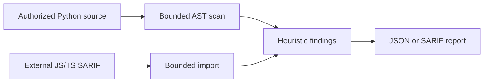

# Architecture and threat model

The CLI receives an explicit local source root. It uses a bounded read-only walk and Python AST parsing, then emits JSON or SARIF. External JS/TS SARIF is parsed as untrusted data and represented with a separate origin marker. No source code or external results are executed.

Threats include malicious source execution, symlink traversal, parser exhaustion, false positive vulnerability claims, and secret leakage from imported SARIF messages. Controls include AST-only parsing, nofollow file opens, depth/file/byte caps, source-free reports, imported-message discard, and explicit heuristic labels. There is no API, database, or frontend in this offline milestone.
